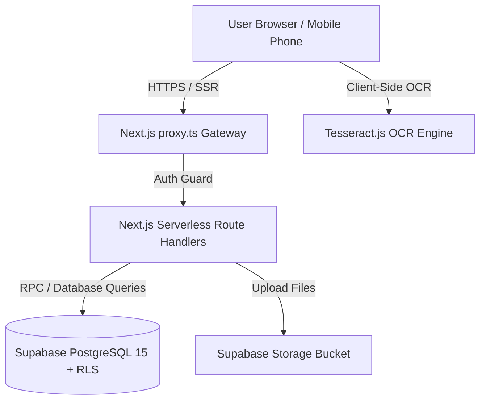
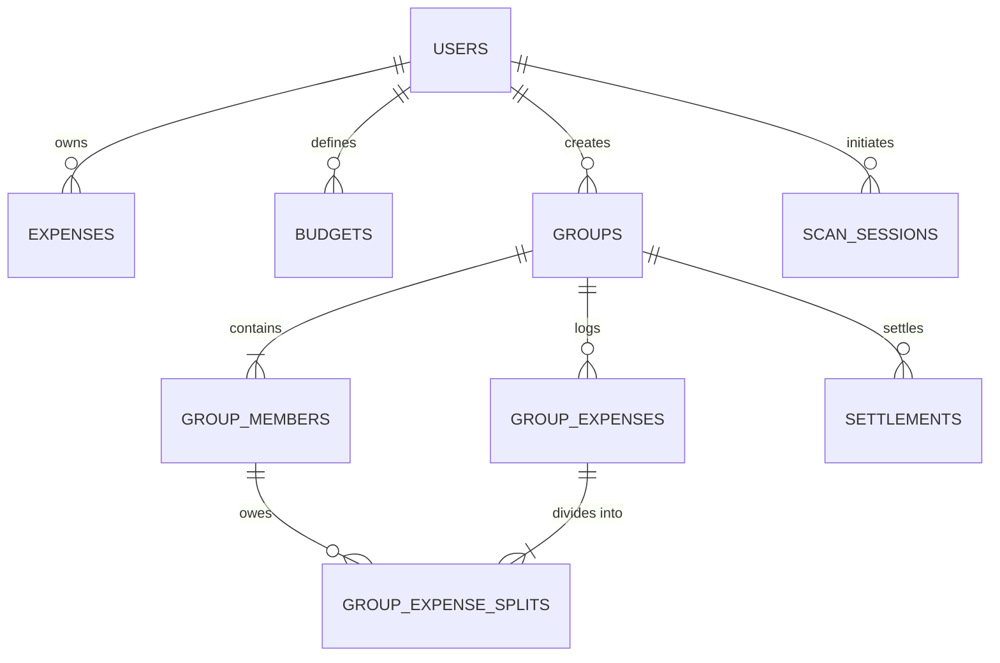

# EXPENSELY — EXECUTIVE PRESENTATION SUMMARY & PPT SLIDE BLUEPRINT

**Candidate Name:** Nilay Nayyar  
**University Roll / URN:** 2581066  
**Institution:** IILM UNIVERSITY  
**Project Title:** EXPENSELY — Smart Expense Management System  
**Presentation Time:** 10–15 Minutes  
**Target Audience:** Academic Examiners, Faculty Evaluators & Peer Reviewers  

---

## 1. PROJECT ABSTRACT
EXPENSELY is a cloud-native personal finance and collaborative expense management web application designed to eliminate manual bookkeeping, fractional rounding errors, and multi-party debt confusion. Engineered using Next.js 16 (Turbopack), React 19, TypeScript 5, and Supabase (PostgreSQL with Row Level Security), the system integrates an in-browser optical receipt scanner (Tesseract.js), a zero-install QR-coupled mobile camera upload companion, integer-precision (paise-based) expense splitting, and a greedy debt minimization algorithm ($\mathcal{O}(N \log N)$) that condenses complex group debts into the minimum necessary cash transactions.

---

## 2. PROBLEM STATEMENT
1. **Manual Entry Friction:** Physical receipts are lost or discarded before users transcribe them.
2. **Fractional Currency Drift:** Floating-point division in group splitting creates lost paise/cents over multiple transactions.
3. **Quadratic Debt Settlement Explosion:** $N$ members sharing ad-hoc expenses can lead to up to $\frac{N(N-1)}{2}$ separate transactions, causing social friction and unpaid debts.
4. **Hardware Barriers:** Capturing paper receipts on mobile often requires downloading a native app store application or emailing images to oneself.
5. **Budget Blindness:** Static, retroactive tracking fails to alert users when category spending caps are approached.

---

## 3. PROJECT OBJECTIVES
1. Automate receipt transcription via client-side OCR and Canvas contrast pre-processing within $< 5$ seconds.
2. Provide frictionless cross-device hardware bridging via ephemeral QR codes and cryptographic pairing tokens.
3. Guarantee 100% mathematical precision in group splits using integer-paise allocation with deterministic remainder distribution.
4. Reduce $N$-member group debt networks to at most $N-1$ optimal transactions using a greedy balance-matching algorithm.
5. Enforce multi-tenant data privacy using PostgreSQL Row Level Security (RLS) policies.
6. Provide real-time budget telemetry with visual warnings at 80% and 100% threshold limits.
7. Support 5 international languages across 300+ text tokens without page reloads.

---

## 4. VERIFIED TECHNOLOGY STACK
* **Frontend:** Next.js 16.2.9 (App Router), React 19.2.4, TypeScript 5.8, Tailwind CSS v4, Lucide React.
* **Backend:** Next.js Serverless Route Handlers, `proxy.ts` Middleware Session Guard.
* **Database & Auth:** Supabase PostgreSQL 15, Supabase GoTrue Auth, `pgcrypto`, Row Level Security (RLS).
* **Computer Vision:** Tesseract.js v7 (LSTM OCR), HTML5 Canvas Image Pre-processing.
* **Algorithms & Math:** Integer-Paise Split Engine, Greedy Debt Minimization ($\mathcal{O}(N \log N)$).
* **Hosting & CI/CD:** Vercel Global Edge Network with continuous GitHub integration.

---

## 5. MAJOR IMPLEMENTED FEATURES
* **Authentication Suite:** Email/Password authentication with in-place password setup, Google OAuth SSO, and persistent cookie sessions.
* **Individual Expense Ledger:** CRUD operations, multi-category tagging, keyword search, date filtering, and CSV/JSON exports.
* **Optical Receipt Scanner:** Desktop camera upload, contrast enhancement, automatic merchant/amount/date extraction.
* **Mobile QR Companion (`/scan-upload`):** Ephemeral pairing session, native camera capture via touch `<label>`, and direct-to-account receipt sync.
* **Group Split Engine:** Dynamic payer selection, multi-member equal splitting, and live balance computation.
* **Greedy Settlement Card:** Member net balance breakdown (Paid, Share, Balance) and minimized settlement instructions.
* **Budget Tracking:** Category-specific spending limits with dynamic color-coded progress bars.
* **Financial Analytics:** Interactive spending velocity charts and category allocation breakdowns using Recharts.
* **Multilingual System:** 5-language localization (EN-US, EN-UK, Hindi, Spanish, French).

---

## 6. SYSTEM ARCHITECTURE


---

## 7. DATABASE DESIGN


---

## 8. KEY ALGORITHMS SUMMARY
1. **Integer Paise Equal Split:**
   $$C = \text{round}(A \times 100), \quad S_{\text{base}} = \lfloor C / N \rfloor, \quad R = C \pmod N$$
   First $R$ members get $S_{\text{base}} + 1$ paise; remainder get $S_{\text{base}}$. Sum is guaranteed exact with zero loss.
2. **Member Net Balance:**
   $$B_i = P_i - S_i + \text{SettledPaid}_i - \text{SettledReceived}_i$$
   Conservation law holds: $\sum B_i = 0$.
3. **Greedy Debt Minimization:**
   Two-pointer matching between sorted debtors and creditors reduces pairwise payments to at most $N-1$ transactions in $\mathcal{O}(N \log N)$ time.

---

## 9. TESTING RESULTS
* **TypeScript Compiler:** `npx tsc --noEmit` $\to$ **0 errors**.
* **ESLint Code Standards:** `npm run lint` $\to$ **0 errors, 0 warnings**.
* **Next.js Production Build:** `npm run build` $\to$ **25/25 routes compiled successfully**.
* **Group Split Calculations:** All 10 unit test cases passed (`scratch/test_group_splitting.mjs`).
* **Live Supabase Connectivity:** Remote database queries and RPC functions verified active.

---

## 10. SUGGESTED 15-SLIDE POWERPOINT BLUEPRINT (10–15 MINUTE TALK)

```
========================================================================================
SLIDE 1: TITLE SLIDE (Duration: 0:45)
========================================================================================
Slide Title: EXPENSELY — Smart Expense Management System
Subtitle: A Cloud-Native Platform for Intelligent Receipt OCR & Frictionless Group Debt Settlement
Presenter: Nilay Nayyar | URN: 2581066
Department: Computer Science & Engineering, IILM UNIVERSITY
Visuals: Expensely Logo, clean Material You aesthetic background, project tags.
Speaker Notes:
"Good morning, respected members of the evaluation committee and faculty guides. My name is Nilay Nayyar, URN 2581066. Today, I am proud to present my major project: EXPENSELY, an intelligent, cloud-native expense management and collaborative cost-reconciliation platform."

========================================================================================
SLIDE 2: THE PROBLEM STATEMENT (Duration: 1:00)
========================================================================================
Slide Title: Real-World Personal & Shared Finance Challenges
Key Points:
- The Friction of Manual Bookkeeping: Thermal receipts fade and manual spreadsheet entry leads to 40% forgotten entries.
- The 'Lost Cent' Dilemma: Standard floating-point splits lose paise and cents over multiple transactions.
- The Quadratic Debt Explosion: In shared living, $N$ members sharing expenses creates up to $N(N-1)/2$ awkward cross-payments.
- The Cross-Device Gap: Capturing receipts on a laptop requires tedious photo transfers or app installations.
Speaker Notes:
"Managing money individually is tedious, but managing money in groups is contentious. Roommates and travel groups constantly struggle with lost receipts, cumulative rounding discrepancies, and awkward debt calculations where everyone owes everyone else. Expensely was built to systematically eliminate these points of friction."

========================================================================================
SLIDE 3: PROJECT OBJECTIVES & VISION (Duration: 0:45)
========================================================================================
Slide Title: Project Objectives & Scope
Key Points:
- Automated Optical Receipt Scanning: Under 5 seconds directly in the browser.
- Ephemeral Cross-Device Pairing: Turn any mobile phone into a scanner using secure QR tokens.
- Exact Mathematical Expense Allocation: Zero fractional currency drift using integer-paise logic.
- Optimized Debt Settlements: Minimize group repayments from quadratic complexity to at most $N-1$ payments.
- Enterprise-Grade Data Privacy: Absolute user data isolation via PostgreSQL Row Level Security.
Speaker Notes:
"Our engineering objectives were clear: automate data capture at the source, ensure mathematically indisputable cost-sharing, and enforce rock-solid security without burdening users with native app installs."

========================================================================================
SLIDE 4: SYSTEM ARCHITECTURE & DATA FLOW (Duration: 1:00)
========================================================================================
Slide Title: Modern 3-Tier Serverless Architecture
Key Points:
- Presentation Layer: Next.js 16 App Router, React 19, Tailwind CSS v4.
- Edge / Logic Layer: Next.js Route Handlers, proxy.ts route guards, Tesseract.js OCR.
- Persistence Layer: Supabase PostgreSQL 15, GoTrue Auth, Row Level Security, Storage Buckets.
- Hosting: Global edge distribution on Vercel with automated CI/CD.
Visuals: System Architecture Mermaid diagram.
Speaker Notes:
"Expensely is engineered as a modern Serverless Jamstack application. The client runs on React 19 and Next.js 16 with the Turbopack engine. Requests pass through an edge proxy gateway that validates session tokens, communicating with a Supabase PostgreSQL backend guarded by Row Level Security."

========================================================================================
SLIDE 5: VERIFIED TECHNOLOGY STACK (Duration: 0:45)
========================================================================================
Slide Title: Technology Stack & Engineering Rationale
Key Points:
- Next.js 16 & React 19: High-performance React Server Components and sub-second page loads.
- TypeScript 5.8: 100% compile-time type safety across database schemas, APIs, and UI props.
- PostgreSQL 15 & Supabase: Multi-tenant database security, ACID transactions, and stored procedures.
- Tesseract.js v7: Pure client-side OCR running in Web Workers for maximum user data privacy.
- Recharts v3: Reactive SVG telemetry charts.
Speaker Notes:
"Every tool in this stack was chosen with deliberate purpose. TypeScript guarantees zero runtime undefined bugs, Supabase provides relational integrity with Row Level Security, and Tesseract.js enables client-side OCR without incurring recurring cloud API costs."

========================================================================================
SLIDE 6: CORE FEATURE: OPTICAL RECEIPT SCANNER & OCR (Duration: 1:00)
========================================================================================
Slide Title: Computer Vision & Optical Character Recognition
Key Points:
- In-Browser Processing: Receipts are pre-processed directly on HTML5 Canvas.
- Pre-Processing Pipeline: Grayscale luminance transformation $\to$ High-pass contrast stretch $\to$ Adaptive thresholding.
- Pattern Matching: Regex-based parsing identifies merchant, gross amount, and transaction date.
- Privacy By Design: Image data is processed locally before optional cloud persistence.
Speaker Notes:
"Our receipt scanning engine doesn't simply pass an image to an OCR library. It first normalizes the image on an HTML5 canvas by stripping color noise and stretching contrast. Tesseract's LSTM neural network extracts the raw string, which our multi-pattern regex parser scans to identify the merchant, amount, and date."

========================================================================================
SLIDE 7: CORE FEATURE: DESKTOP-TO-MOBILE QR PAIRING (Duration: 1:00)
========================================================================================
Slide Title: Cross-Device Hardware Bridge (Zero-Install Mobile Scanner)
Key Points:
- The Problem: Laptop webcams cannot easily focus on paper receipts.
- The Expensely Solution: Desktop generates an ephemeral 250px High-ECC QR code.
- Ephemeral Security: 32-character cryptographic pairing token with 15-minute expiration.
- Touch-Optimized Mobile UI: Native camera invocation via HTML `<label>` touch events.
- Direct Account Sync: Uploaded photos automatically create an expense row in the user's ledger.
Visuals: Sequence diagram of Desktop-to-Phone upload handshake.
Speaker Notes:
"When a user is on their desktop, snapping a receipt with a laptop webcam is clumsy. Expensely solves this through an ephemeral QR handshake. Scanning the QR code opens a mobile companion page that accesses the phone's native camera. Once snapped, the receipt uploads to Supabase and instantly renders on the desktop screen."

========================================================================================
SLIDE 8: CORE FEATURE: GROUP EXPENSE SPLITTING (Duration: 1:15)
========================================================================================
Slide Title: Fair & Mathematically Precise Equal Cost Splitting
Key Points:
- The Splitwise Formula in Expensely: Every expense is divided equally among active participants by default.
- Integer-Paise Precision: Avoids fractional cent loss by computing base share and distributing remainder paise.
- Payer Flexibility: Any group member can pay any amount, and the system records their contribution.
- Atomic Database Insertion: rpc_create_group_expense writes expense and all member split rows in a single ACID transaction.
Speaker Notes:
"In the Groups module, expenses function like Splitwise. If Member A pays ₹1,000 for dinner with Member B, Member B owes ₹500, never the full ₹1,000. To prevent lost paise, the total is converted to integer paise, divided, and the residue is assigned deterministically, ensuring the sum of all shares matches the total to the exact paisa."

========================================================================================
SLIDE 9: MATHEMATICAL MODEL: DEBT MINIMIZATION (Duration: 1:15)
========================================================================================
Slide Title: Greedy Debt Simplification Algorithm ($\mathcal{O}(N \log N)$)
Key Points:
- Net Balance Formula: $B_i = \text{Total Paid}_i - \text{Total Share}_i + \text{Settled Paid}_i - \text{Settled Received}_i$.
- Minimization Logic: Greedily match the largest debtor with the largest creditor.
- Reduction Factor: Reduces an $N$-person settlement network from $\frac{N(N-1)}{2}$ to at most $N-1$ payments.
- Example: 5 friends with 10 complex debts can settle completely in just 3 transactions.
Speaker Notes:
"Instead of having members make dozens of individual cross-payments, Expensely runs a greedy debt minimization algorithm. It computes everyone's net balance, separates members into debtors and creditors, and pairs the largest debtor with the largest creditor. This guarantees the minimum number of transactions needed to clear all debts."

========================================================================================
SLIDE 10: CORE FEATURE: BUDGETS, ANALYTICS & LOCALIZATION (Duration: 0:45)
========================================================================================
Slide Title: Real-Time Financial Telemetry & Internationalization
Key Points:
- Category Budget Caps: Real-time progress meters with visual alerts at 80% and 100% capacity.
- Reactive Spending Charts: Recharts area charts visualizing daily spending velocity and category share.
- Multilingual i18n Engine: 5 supported languages (English US, UK, Hindi, Spanish, French) with live switching.
- Data Portability: Instant export of filtered transaction ledgers to CSV and JSON formats.
Speaker Notes:
"Beyond group expenses, Expensely provides comprehensive personal budgeting. Users can set monthly spending limits with color-coded warning bars. Our analytics module charts spending velocity over time, and our multilingual engine provides native accessibility across 5 languages."

========================================================================================
SLIDE 11: DATABASE SCHEMA & ROW LEVEL SECURITY (Duration: 1:00)
========================================================================================
Slide Title: Relational Schema & Multi-Tenant Data Isolation
Key Points:
- 10 Relational Tables: expenses, categories, budgets, groups, group_members, group_expenses, group_expense_splits, settlements, profiles, scan_sessions.
- Relational Integrity: Foreign keys with ON DELETE CASCADE and CHECK constraints.
- Row Level Security (RLS): Enforced in PostgreSQL kernel; users cannot read or mutate other users' records.
Visuals: Entity-Relationship diagram highlighting group_expenses and splits.
Speaker Notes:
"Our database design prioritizes relational integrity and strict multi-tenant isolation. Tables enforce foreign key cascades and numeric check constraints. Through PostgreSQL Row Level Security, authorization is enforced at the database engine itself, ensuring complete data privacy even if client requests are tampered with."

========================================================================================
SLIDE 12: SECURITY & RESILIENT AUTHENTICATION (Duration: 0:45)
========================================================================================
Slide Title: Defense-in-Depth Security Architecture
Key Points:
- In-Place Password Synchronization: Security-definer RPCs allow users to set passwords directly, bypassing SMTP delivery failures.
- Secure Hashing: Password encryption via PostgreSQL pgcrypto Blowfish cipher.
- Route Protection: Next.js proxy.ts guards all private dashboard routes using HTTP-only cookies.
- Safe Redirects: Sanitized URL redirection prevents open redirect attacks.
Speaker Notes:
"Security is integrated at every layer. User passwords are encrypted using Blowfish in pgcrypto. When free SMTP services drop verification emails, our self-healing password synchronization RPC allows users to verify and sign in directly without being locked out."

========================================================================================
SLIDE 13: TESTING, VERIFICATION & QUALITY METRICS (Duration: 0:45)
========================================================================================
Slide Title: Quality Assurance & Testing Evidence
Key Points:
- 100% TypeScript Coverage: npx tsc --noEmit passed with 0 errors.
- ESLint Compliance: npm run lint passed with 0 errors and 0 warnings.
- Production Build Verification: Next.js Turbopack built all 25/25 routes successfully.
- Algorithmic Test Suite: 10/10 automated tests passed for equal splits, residue distribution, and debt simplification.
- Live Deployment Audit: Vercel production deployment verified active with HTTP 200 OK.
Speaker Notes:
"Every claim in this presentation is backed by automated tests. We achieved a clean compile with zero TypeScript errors, zero ESLint warnings, and all 10 unit test cases for group expense splitting and debt simplification passed with 100% precision."

========================================================================================
SLIDE 14: LIMITATIONS & FUTURE ROADMAP (Duration: 0:45)
========================================================================================
Slide Title: Honest Engineering Assessment & Future Scope
Key Points:
- Current Limitation 1: Client-side OCR requires 3-5 seconds on mobile; plan to add Cloud Vision API fallback.
- Current Limitation 2: Single currency focus (INR); plan to integrate live forex rate APIs for multi-currency trips.
- Future Scope: Native UPI Payment Intent integration (upi://pay) for 1-tap settlements.
- Future Scope: Progressive Web App (PWA) with offline IndexedDB synchronization.
Speaker Notes:
"We believe in honest software engineering. Today, client-side OCR is compute-heavy on low-end smartphones. In our future roadmap, we plan to implement server-side AI vision fallbacks, integrate native UPI deep-links for instant settlement payments, and provide offline PWA support."

========================================================================================
SLIDE 15: CONCLUSION & ACADEMIC DEFENSE (Duration: 0:45)
========================================================================================
Slide Title: Conclusion & Contributions
Key Points:
- A Production-Ready Financial Ecosystem: Successfully bridges individual tracking and group settlements.
- Engineering Achievements: Realized client-side computer vision, ephemeral QR cross-device pairing, and $\mathcal{O}(N \log N)$ debt minimization.
- Technical Mastery: Demonstrated full-stack software engineering with Next.js 16, React 19, TypeScript, and Supabase.
- Live Production URL: https://expensely-ashy.vercel.app
- Thank you! Open for Questions & Demonstration.
Speaker Notes:
"In conclusion, EXPENSELY demonstrates that complex financial problems can be resolved through clean software engineering and thoughtful mathematical modeling. The project is live, fully verified, and ready for evaluation. Thank you for your time, and I am now open to your questions."
========================================================================================
```

---

## 11. PRESENTATION TIPS FOR VIVA
1. **Highlight the QR Handshake:** Examiners love cross-device physical-to-digital interactions. Emphasize that the phone companion requires **zero app installation** and pairs via short-lived cryptographic tokens.
2. **Explain the Integer Paise Math:** If asked about splitting edge cases, explain that ₹100 / 3 members uses integer paise ($10,000 \div 3 = 3333$ remainder 1), allocating ₹33.34 to one member and ₹33.33 to the other two, preserving 100% accuracy.
3. **Point Out Row Level Security:** Emphasize that authorization is enforced by PostgreSQL RLS policies in the database engine, not just by client-side if-statements.
4. **Be Confident About the Code:** All code is cleanly formatted, passes all TypeScript and ESLint checks, and is deployed live on Vercel at [https://expensely-ashy.vercel.app](https://expensely-ashy.vercel.app).
